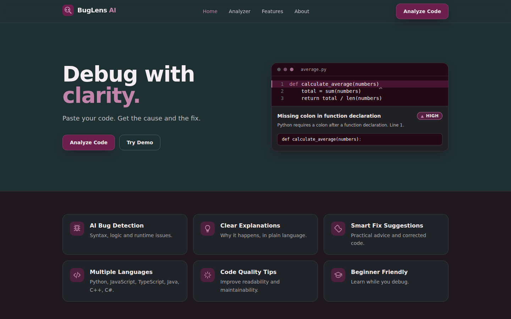
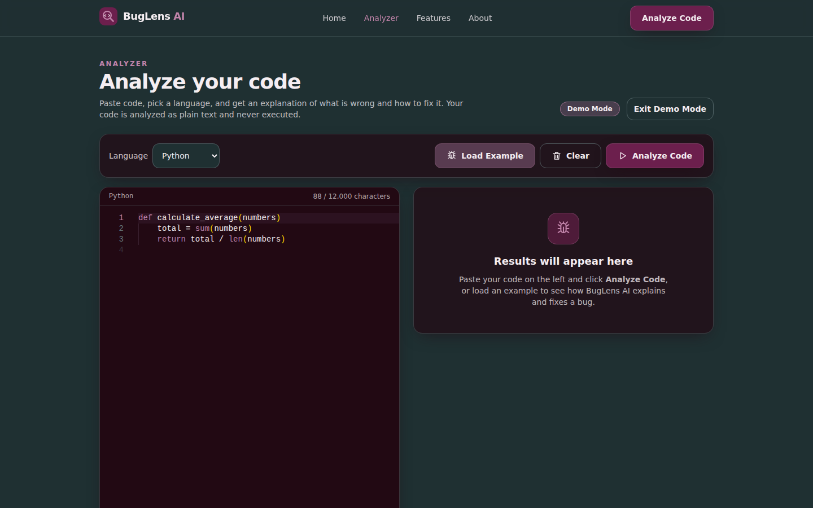
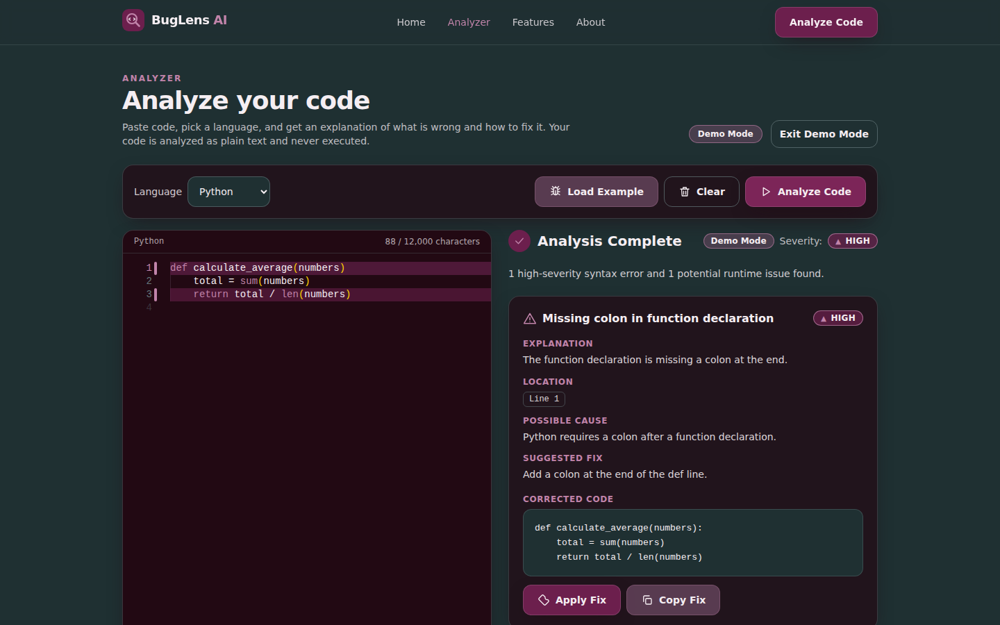
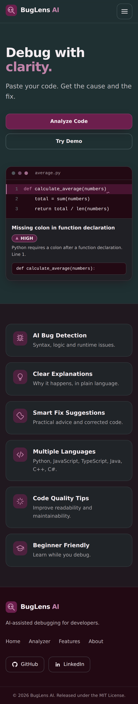

# BugLens AI

> **Find bugs. Understand code. Build better.**

BugLens AI is an AI-powered web application that helps developers detect, understand, and fix bugs in their source code. Paste code into a Monaco-powered editor, and get a structured analysis with the issue, its location, the likely cause, a suggested fix, corrected code, a severity level, and code-quality tips.

## Overview

BugLens AI is a full-stack Next.js (React + TypeScript) application. The browser never talks to the AI provider directly: it calls a server-side API route (`/api/analyze`) that validates the request, calls the AI with a server-only API key, validates the AI's JSON response, and returns a clean result to the UI. User code is treated strictly as text and is **never executed**.

## Problem Statement

Developers and students spend a lot of time locating and understanding coding errors. Compiler and interpreter messages are often cryptic, especially for beginners, and they rarely explain *why* something is wrong or how to fix it.

## Solution

BugLens AI combines a familiar code editor with AI analysis to turn a confusing error into a clear explanation: what is wrong, where, why it happens, and what the corrected code looks like.

## Features

- AI bug detection (syntax errors, logic issues, potential runtime problems)
- Clear explanations, error location, and possible cause
- Suggested fixes with corrected code, plus **Apply Fix** and **Copy Fix** buttons
- Severity levels: `CRITICAL`, `HIGH`, `MEDIUM`, `LOW`, `INFO` (always shown as text, never color alone)
- Code improvement suggestions
- Six languages: Python, JavaScript, TypeScript, Java, C++, C#
- Monaco Editor with syntax highlighting and issue-line highlighting
- **Demo Mode** that works with no API key
- Recent Analyses saved in `localStorage`, with Clear History
- Friendly error states, loading state, responsive layout, accessible UI
- Rate limiting, input validation, and size limits on the API

## Tech Stack

| Area | Technology |
| --- | --- |
| Frontend | React 19, TypeScript, Tailwind CSS |
| Framework / Backend | Next.js 15 (App Router), Node.js API route |
| Editor | Monaco Editor (`@monaco-editor/react`) |
| AI | Server-side call to an AI API (Anthropic Messages API by default) |
| Testing | Vitest, Testing Library |
| Deployment | Vercel |

## Architecture

```
User → Web Interface (React) → POST /api/analyze (Node.js)
     → validate request → AI Service → validate JSON response
     → Results Interface
```

- `lib/validation.ts` validates requests and AI responses.
- `lib/ai.ts` builds the prompt, calls the AI, and extracts JSON. It runs only on the server.
- `app/api/analyze/route.ts` enforces size limits, rate limits, and safe error handling.
- Demo Mode runs entirely in the browser with predefined results in `lib/samples.ts`.

## Project Structure

```
buglens-ai/
├── app/
│   ├── layout.tsx
│   ├── page.tsx                  # Landing page
│   ├── globals.css
│   ├── analyzer/
│   │   ├── page.tsx              # /analyzer
│   │   └── AnalyzerClient.tsx
│   ├── about/page.tsx            # /about
│   └── api/analyze/route.ts      # Secure AI endpoint
├── components/                   # Navbar, Footer, CodeEditor, AnalysisResult, SeverityBadge, ...
├── lib/                          # ai.ts, validation.ts, storage.ts, samples.ts, languages.ts, rateLimit.ts, types.ts
├── __tests__/                    # Vitest tests
├── docs/screenshots/             # README screenshots
├── scripts/copy-monaco.mjs       # serves Monaco from this site (no CDN)
├── .env.example
├── .gitignore
├── LICENSE
├── PROJECT_DOCUMENTATION.md
└── README.md
```

## Installation

Requirements: Node.js 18.18+ (Node 20+ recommended) and npm.

```bash
git clone https://github.com/<your-username>/buglens-ai.git
cd buglens-ai
npm install
```

## Environment Variables

Copy `.env.example` to `.env.local` and fill in your values. **Never commit real keys.**

| Variable | Required | Description |
| --- | --- | --- |
| `AI_API_KEY` | For live analysis | AI provider API key (server-side only) |
| `AI_MODEL` | No | Model name (default `claude-sonnet-4-5`) |
| `AI_API_URL` | No | API endpoint (default Anthropic Messages API) |
| `MAX_CODE_CHARS` | No | Max characters of code accepted (default `12000`) |
| `RATE_LIMIT_PER_MINUTE` | No | Requests per IP per minute (default `10`) |

## Running Locally

```bash
cp .env.example .env.local   # then add AI_API_KEY (optional)
npm run dev                  # http://localhost:3000
npm test                     # run the tests
npm run typecheck            # TypeScript check
npm run lint                 # ESLint (next/core-web-vitals)
npm run build && npm start   # production build
```

## Demo Mode

Click **Try Demo** on the home page (or open `/analyzer?demo=1`). Demo Mode loads sample code and returns predefined analysis results, so the site is fully usable with **no API key**. A "Demo Mode" label is shown wherever demo results appear. The Analyzer also suggests Demo Mode if the live AI is not configured.

## Deployment

### Which host?

BugLens AI **cannot run on GitHub Pages**. Pages only serves static files, but this app needs a server-side API route (`/api/analyze`) to keep the AI key secret. **Vercel** is the recommended host: it runs Next.js natively, has a free tier, and deploys automatically from GitHub. No extra configuration file is needed.

### 1. Put the code on GitHub

Create an empty repository on github.com (no README or license), then from the project folder:

```bash
git init -b main            # skip if the folder is already a git repository
git add .
git commit -m "Initial commit"
git remote add origin https://github.com/<your-username>/buglens-ai.git
git push -u origin main
```

`.env` files are git-ignored, so no secrets are uploaded. Check with `git ls-files | grep env` (only `.env.example` should appear).

### 2. Publish with Vercel

1. Sign in at [vercel.com](https://vercel.com) with your GitHub account.
2. Choose **Add New → Project** and import the `buglens-ai` repository. Next.js is detected automatically.
3. Under **Environment Variables** add `AI_API_KEY` (and optionally `AI_MODEL`, `MAX_CODE_CHARS`, `RATE_LIMIT_PER_MINUTE`).
4. Click **Deploy**.

When the build finishes, the public URL is shown on the project's page in the Vercel dashboard (shaped like `https://<project-name>.vercel.app`; see **Settings → Domains**). Every later `git push` redeploys automatically. Add the URL to this README once it exists.

Without `AI_API_KEY` the deployed site still works in Demo Mode.

## Security Considerations

- The API key lives only in server environment variables and is never sent to the browser.
- User code is treated as plain text. It is never executed: no `eval()`, no `exec()`, no code running.
- The prompt marks the code as data to reduce prompt-injection risk.
- Requests are validated (type, language allow-list, empty input, maximum size).
- The AI response is validated and normalised before display.
- A per-IP rate limit and body-size cap protect the endpoint. (The in-memory limiter suits a single instance; use a shared store like Redis for multi-instance production.)
- Provider error details are never forwarded to the client.
- Security headers are set in `next.config.mjs`.

## Screenshots

Captured from the running app in Demo Mode:

| Home | Analyzer |
| --- | --- |
|  |  |

| Analysis result | Mobile |
| --- | --- |
|  |  |

## Future Improvements

- More programming languages
- GitHub repository integration and Pull Request analysis
- Advanced static analysis combined with AI
- Team collaboration and shared analyses
- Personalized learning recommendations
- Shared rate limiting (Redis) and optional user accounts

## Contributing

Contributions are welcome. Fork the repo, create a feature branch, add tests for your change, run `npm test` and `npm run typecheck`, and open a pull request. To add a language, add an entry in `lib/languages.ts` and a sample in `lib/samples.ts`.

## License

Released under the [MIT License](LICENSE).
